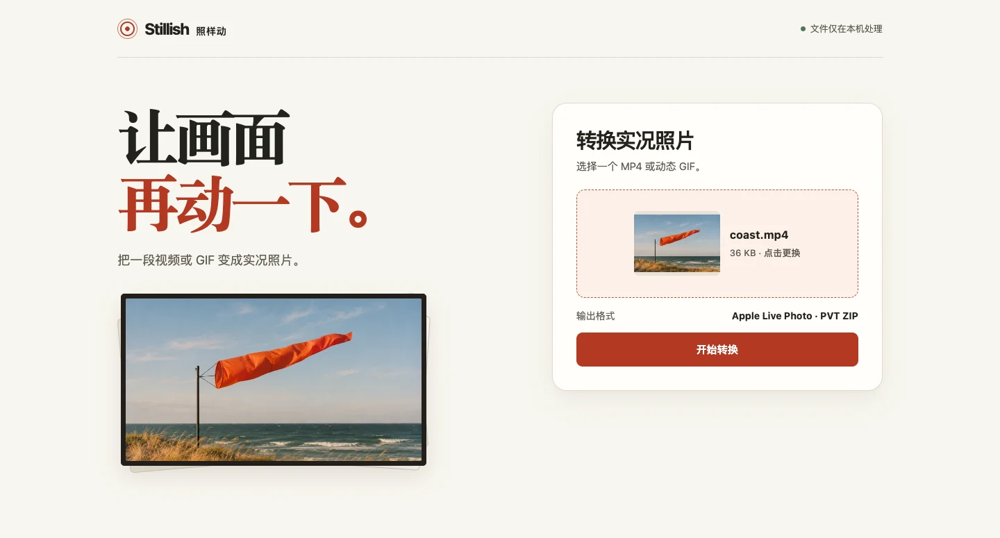

<h1 align="center">Stillish</h1>

<p align="center"><a href="README.zh-CN.md">简体中文</a></p>

<p align="center"><strong>Turn MP4 videos and animated GIFs into Apple Live Photos and Android Motion Photos.</strong></p>

<p align="center">In your browser or from the command line. Your media stays on your device.</p>

## Convert in your browser



1. Open the web app locally. [Run the web app](docs/TECHNICAL.md#本地运行)
2. Choose an MP4 or animated GIF. Stillish shows a thumbnail when your browser can decode a preview.
3. Select **开始转换** (Convert), follow the progress, then download your motion photo. The first conversion loads the engine if needed.

Stillish picks the download format for your device.

| Device | Download | How to open it |
| --- | --- | --- |
| Mac, iPhone, or iPad | `clip.pvt.zip` | Unzip it and import the `.pvt` package into Photos on a Mac. |
| Android, Windows, or other devices | `clipMP.jpg` | Use a gallery that supports Android Motion Photo to play it. |

Stillish converts the full MP4 or one loop of a GIF and uses the middle frame as the cover. It keeps the first MP4 audio track when present. GIFs are silent, with transparent areas filled in white.

## Use the macOS CLI

Download the standalone Apple silicon build and save it as `stillish`. In Terminal, replace the example filename with your MP4 or GIF. [Download the CLI](https://github.com/JDChi/stillish/releases/latest)

```sh
chmod +x stillish
./stillish clip.mp4
./stillish animation.gif --target android
```

The default output is an Apple `.pvt` package. Add `--target android` for an `MP.jpg`. You can also trim a clip and pick a cover frame.

```sh
./stillish clip.mp4 --start 2 --duration 3 --cover 1 --out ./out
```

This takes three seconds starting at the two-second mark and sets the cover one second into that clip. See `./stillish --help` for all options.

**Sharing via WeChat.** Send the Apple web ZIP as a file. For a CLI `.pvt` package or a Motion Photo JPG, put the original in a ZIP and send the ZIP as a file to preserve the motion.
