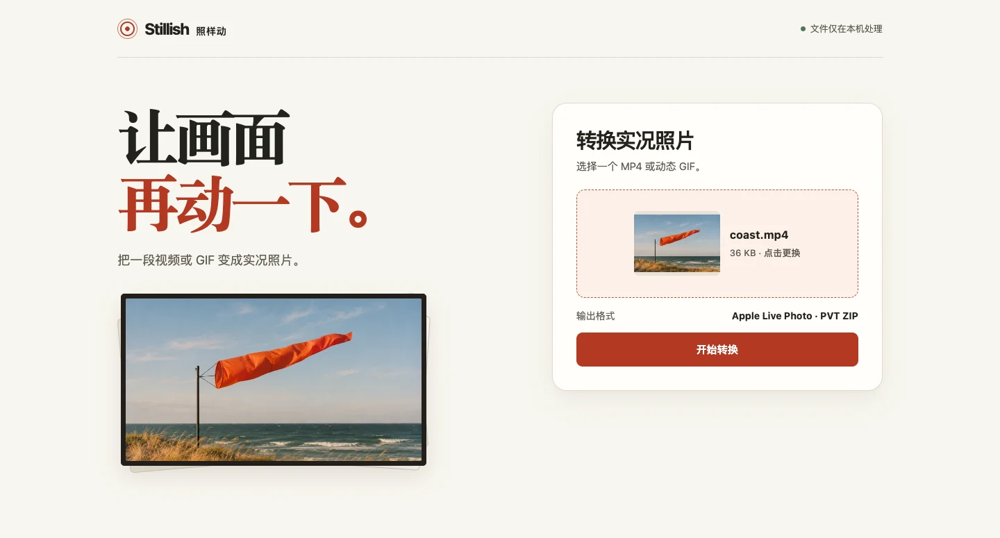

<h1 align="center">照样动 · Stillish</h1>

<p align="center"><a href="README.md">English</a></p>

<p align="center"><strong>把 MP4 视频和 GIF 动图变成 Apple 实况照片或 Android 动态照片。</strong></p>

<p align="center">用浏览器或命令行转换，素材留在本机。</p>

## 在浏览器里转换



1. 在本地打开网页版。 [运行网页版](docs/TECHNICAL.md#本地运行)
2. 选择一个 MP4 或 GIF 动图。浏览器能解码时，页面会显示一张缩略图。
3. 点击「开始转换」，查看进度，完成后下载实况照片。首次转换会按需加载引擎。

Stillish 会根据设备自动选择下载格式。

| 设备 | 下载文件 | 打开方式 |
| --- | --- | --- |
| Mac、iPhone 或 iPad | `clip.pvt.zip` | 解压得到 `.pvt`，在 Mac 的「照片」中导入。 |
| Android、Windows 或其他设备 | `clipMP.jpg` | 在支持 Android Motion Photo 的相册中播放。 |

默认转换整段 MP4 或一轮 GIF，用中间帧当封面。有声 MP4 保留第一条音轨。GIF 成品无声，透明区域填白。

## 在 Mac 上用命令行转换

下载 Apple 芯片版单文件程序，保存为 `stillish`。在终端中，把示例文件名换成你的 MP4 或 GIF 路径。 [下载 CLI](https://github.com/JDChi/stillish/releases/latest)

```sh
chmod +x stillish
./stillish clip.mp4
./stillish animation.gif --target android
```

默认生成 Apple `.pvt`。加 `--target android` 生成 `MP.jpg`。命令行还可以截取片段和指定封面。

```sh
./stillish clip.mp4 --start 2 --duration 3 --cover 1 --out ./out
```

这条命令从原片第 2 秒开始截取 3 秒，并用片段内第 1 秒的画面做封面。完整参数见 `./stillish --help`。

**通过微信传输。** 网页版生成的 Apple ZIP 可以直接当文件发送。命令行生成的 `.pvt` 或动态照片 JPG，可以先压成 ZIP 再当文件发送，以保留实况内容。
