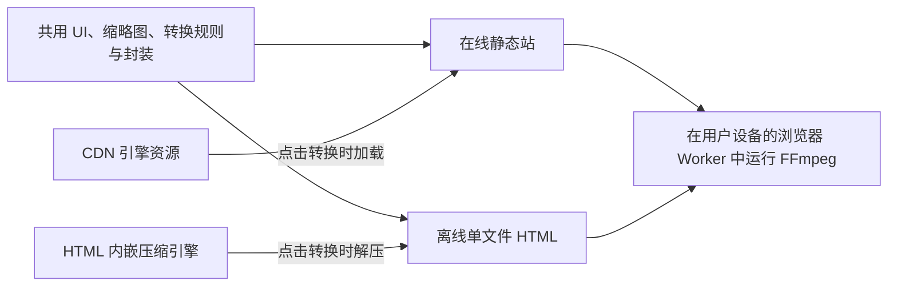

# Stillish 单文件离线版设计

## 交付与使用

离线版的交付物是一个 `Stillish-offline.html`。用户双击后用桌面浏览器打开，选择 MP4 或动态 GIF，转换完成后下载成品。设计目标是从第一次打开到下载都能在断网状态下完成。页面、样式、图片、转换引擎和第三方许可说明都随这个 HTML 交付。

素材和成品都留在用户设备上。输出沿用现有规则，Apple 设备下载包含完整实况照片包的 `.pvt.zip`，其他设备下载带内嵌视频的 `MP.jpg`。

## 一套源码，两种交付

在线版和离线版共用选文件、缩略图、进度、取消和下载界面，也共用转码参数、封面计算和实况封装。转换流程向引擎发出相同的媒体探测、转码和读取请求。两条接入路径分别处理引擎的来源与启动方式。

在线版延续静态部署，浏览器在需要转换时下载引擎。离线版在构建时收齐资源，把它们组合为一个自包含页面。两种构建以同一固定版本的 FFmpeg WASM 为基础，便于比较转码行为和成品兼容性。 [FFmpeg WASM 架构](https://ffmpegwasm.netlify.app/docs/overview/)

## 一个 HTML 如何运行 FFmpeg

构建时，将 FFmpeg WASM 先做 gzip 压缩，再用 Base64 变成可以放进 HTML 数据块的文本。页面脚本和 Worker 脚本也随 HTML 内嵌。用户点击转换后，页面从本地数据创建经典 Worker。Worker 解码并解压引擎，将得到的 WASM 字节交给 FFmpeg 初始化，然后处理素材。引擎初始化和转码在 Worker 中运行，界面继续显示状态并响应取消。 [Worker 加载规则](https://developer.mozilla.org/en-US/docs/Web/API/Worker/Worker) · [浏览器解压接口](https://developer.mozilla.org/en-US/docs/Web/API/DecompressionStream)

本地页面使用 `file://` 打开。早期测试中，Chrome 和 WebKit 对使用 Blob URL 的模块 Worker 或其动态导入出现了加载失败。自包含的经典 Worker 则通过了测试，并能直接使用传入的 WASM 字节。这个结果是离线版选用经典 Worker 的依据。

| 数据形态 | 实测大小 |
| --- | ---: |
| 原始 FFmpeg WASM | 约 30.7 MiB |
| gzip 压缩后的 WASM | 约 9.7 MiB |
| 压缩后转为 Base64 的引擎数据 | 约 13.0 MiB |
| 加入引擎加载脚本和验证逻辑的单文件原型 | 约 13.1 MiB |

压缩降低了 WASM 的体积，Base64 再增加约三分之一。13.1 MiB 是验证原型的大小，正式 HTML 还会包含完整界面与封装逻辑。发布时在同一个 HTML 内附上引擎和第三方依赖的许可说明。 [FFmpeg WASM 许可说明](https://ffmpegwasm.netlify.app/docs/faq/#what-is-the-license-of-ffmpegwasm)

## 体积与使用体验

评价打开速度时，需要分别看**首屏出现**、**界面可操作**和**引擎就绪**。这三个时刻可以相差几秒。页面图文可以先绘制，选文件和缩略图也可以先用。若用户点击转换时引擎仍在传输或初始化，界面显示准备状态，等引擎就绪后再开始转码。

一次桌面 Chrome 的冷启动对照使用同一套 Stillish 界面、真实大小的引擎数据和 gzip HTTP 响应，模拟 10 Mbps 下行与 50 ms 延迟。两种内嵌方式都在约 0.7 秒画出首屏，交互的差异来自脚本执行时机。 [HTML 脚本执行规则](https://html.spec.whatwg.org/multipage/scripting.html#attr-script-async)

| 方式 | 打开页面到选文件成功 | 引擎数据的接收时机 |
| --- | ---: | --- |
| 页面和引擎分开 | 约 0.7 秒 | 点击转换后开始下载 |
| 引擎内嵌，沿用现有模块脚本的执行顺序 | 约 8.5 秒 | 打开页面时开始下载 |
| 引擎内嵌，UI 脚本提前初始化 | 约 0.7 秒 | 打开页面时开始下载，约 8.3 秒收完 |

在线版保留按需下载，浏览页面的用户可以先操作轻量界面，只在转换时接收引擎数据。离线版将引擎提前装进交付文件，文件到手后可以立即离线打开，解压和初始化等到点击转换再执行。最终 HTML 若在 25 MiB 单文件上限内，也可以作为同一个静态文件部署到 Cloudflare Pages，此时线上首访会接收内嵌的引擎数据。 [Cloudflare Pages 单文件限制](https://developers.cloudflare.com/pages/platform/limits/#file-size)

## 验证状态与验收

现有原型把真实 FFmpeg WASM 内嵌到一个 HTML。Chrome 和 WebKit 的隔离会话阻断了 HTTP 和 HTTPS 请求，从 `file://` 打开原型后，两个环境都把一段合成 GIF 转成了约 1.5 秒的 MP4，观测到的网络请求为零。这个原型验证了引擎的离线启动和转码链路。

### 完整版验收

- 在全新桌面浏览器会话中阻断网络，从本机直接打开最终的单个 HTML，选取 MP4 和动态 GIF 并完成转换。
- 下载两种实况照片。核对时长和封面时刻，检验 Apple 配对标识与定时元数据，以及 Android XMP 记录的视频长度和内嵌 MP4。用有声 MP4 验证音轨，用循环 GIF 验证一轮播放。
- 连续转换两个文件后核对进度，验证初始化、转码、取消及重试。检查取消后可以重新启动引擎，成功后可以继续转换和下载。
- 确认最终交付为一个 HTML，首次使用全程无网络请求。分别记录浏览器内转码结果和真机相册播放结果。
