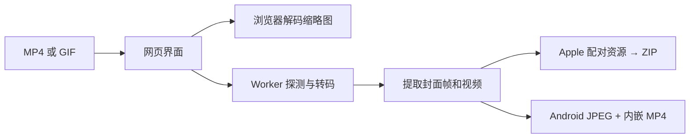

# Stillish 网页版技术说明

Stillish 在浏览器里把 MP4 和动态 GIF 转成实况照片。静态站点提供页面，CDN 提供转换引擎。浏览器负责读取素材、生成封面和输出成品。这种架构让素材留在用户的设备上，也让网站可以使用静态托管。

## 架构分层

界面负责选文件、显示缩略图、反馈进度和提供下载。转换层管理浏览器 Worker 的生命周期，按顺序执行探测、转码、提取封面和打包。格式核心定义两端共用的转码规则、封面时刻和实况元数据。命令行接入原生 FFmpeg，网页接入单线程 FFmpeg WASM，两端沿用同一套封装规则。 [FFmpeg WASM 用法](https://ffmpegwasm.netlify.app/docs/getting-started/usage/)

## 从媒体到实况照片

选文件后，浏览器先用自己的媒体解码能力尝试绘制一张静态缩略图。点击转换后，FFmpeg 在 Worker 里读取素材。ffprobe 提供视频轨道、时长和帧数，用于判断输入是否有效、计算转码进度，以及定位成品的封面帧。 [ffprobe 参考](https://ffmpeg.org/ffprobe.html)

MP4 转成 30 fps 的 H.264 视频，有音轨时保留第一条并编码为 AAC。GIF 按帧停留时间展开，只转换一轮，透明区域填白。转码完成后再从实际输出视频里选中间帧，生成 JPEG 封面。这样，封面和封装写入的时间标记指向同一帧。

## 两种输出的原理

| 格式 | 构成 | 网页下载 |
| --- | --- | --- |
| Apple Live Photo | 一张 JPEG 和一段 MOV 共用配对标识，MOV 另有定时元数据标记封面时刻。两项资源随清单组成一个 `.pvt` 包目录。 | Mac、iPhone 和 iPad 下载 `.pvt.zip`，解压得到完整的包目录。 |
| Android Motion Photo | JPEG 提供静态封面，MP4 位于 JPEG 结束标记之后。XMP 记录内嵌视频长度和封面时刻，兼容相册据此定位并播放视频。 | Android、Windows 和其他设备下载 `MP.jpg`。 |

Apple 的资源包需要作为一个完整目录交付，ZIP 使网页可以用一次下载传输它。Android 将封面和视频保存在同一个 JPEG 中，普通图片查看器可以显示封面。输出格式根据浏览器的平台信息自动选择。 [Apple 配对资源接口](https://developer.apple.com/documentation/photos/phlivephoto) · [Android Motion Photo 规范](https://developer.android.com/media/platform/motion-photo-format)

## 加载、进度和取消

引擎在首次点击转换时按需加载。同一页面的后续转换复用已经初始化的 Worker。重新打开页面后，浏览器可以从 HTTP 缓存复用引擎资源，并重新启动 Worker。

引擎下载和视频转码以不同的量来计算进度。下载按收到的字节数计算，等待较久时在状态文字中显示。转码按已处理的媒体时间与当前文件时长的比例计算，跳过无效时间戳。提取封面与打包使用阶段提示。界面保持进度区位置固定，避免阶段切换造成布局跳动。 [FFmpeg WASM 进度事件](https://ffmpegwasm.netlify.app/docs/api/ffmpeg/classes/ffmpeg/)

页面同一时间处理一个文件。取消时中止下载或终止 Worker，下一次转换可以重新加载引擎。实际能处理多大的素材取决于设备性能和浏览器可用内存，原因是输入、解码后的画面和打包产物都需要在本机暂存。

## 静态托管

Vite 将界面构建为静态资源，Cloudflare Pages 可以直接托管。FFmpeg 引擎约 31 MiB，浏览器从 CDN 单独加载，因此静态站点的每个资源都能满足 Pages 的 25 MiB 单文件上限。FFmpeg 执行、媒体封装和下载都发生在浏览器。 [Cloudflare Pages 文件大小限制](https://developers.cloudflare.com/pages/platform/limits/#file-size)
